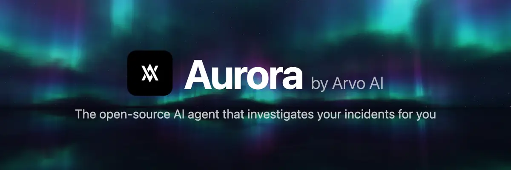
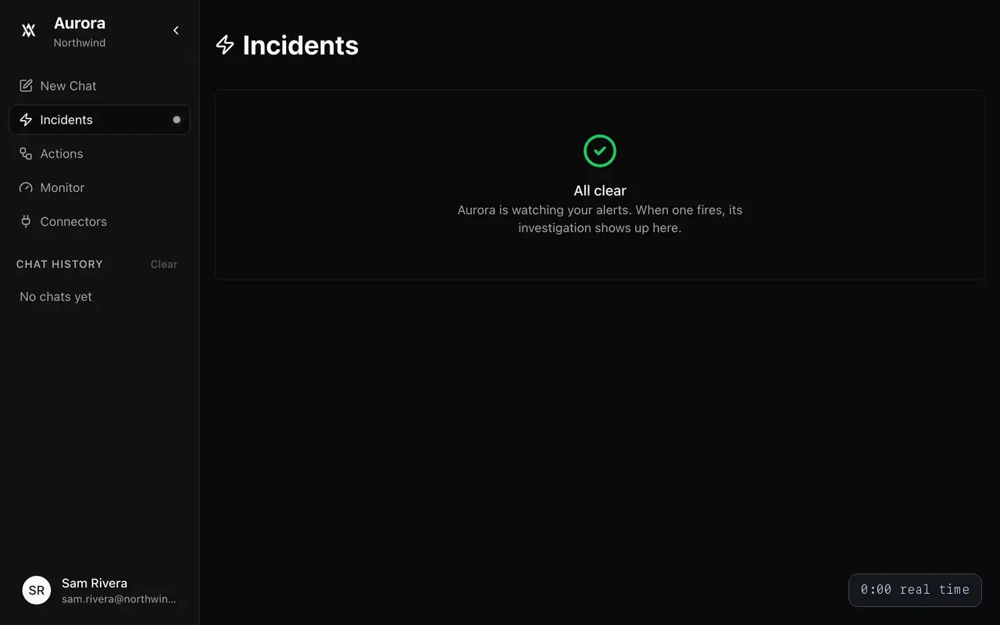
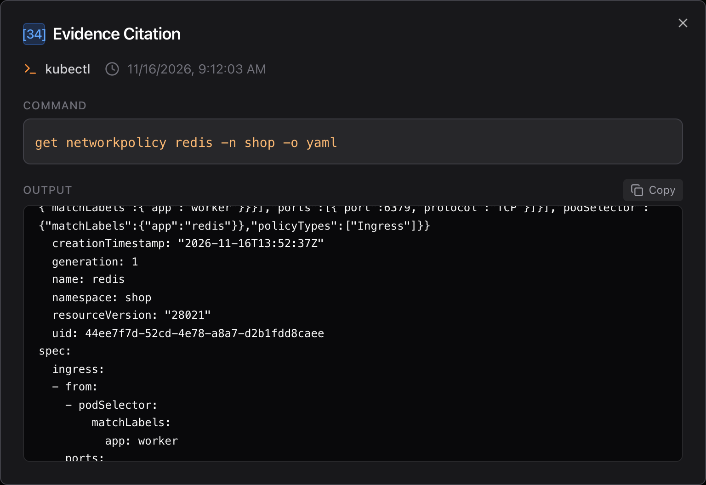
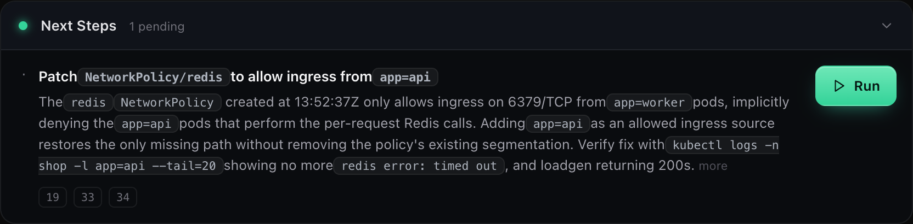
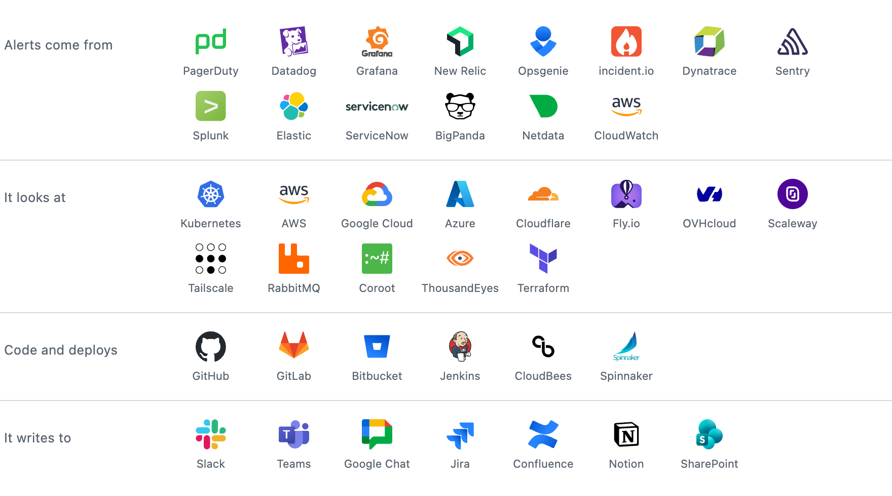

<div align="center">



<br />

<a href="https://github.com/Arvo-AI/aurora/stargazers"></a>
<a href="https://github.com/Arvo-AI/aurora/releases/latest"></a>
<a href="LICENSE"></a>
<a href="https://discord.com/invite/ccbN4FwHxM"></a>

<a href="#run-it">Run it</a> &nbsp;·&nbsp;
<a href="https://aurora-ai.net">Hosted version</a> &nbsp;·&nbsp;
<a href="https://arvo-ai.github.io/aurora/">Docs</a> &nbsp;·&nbsp;
<a href="https://www.aurorasre.ai/benchmark">Benchmark</a> &nbsp;·&nbsp;
<a href="CHANGELOG.md">Changelog</a>

</div>

<br />

When an alert fires, Aurora opens an investigation on its own. It runs read-only commands against your clusters, clouds and observability tools, works through hypotheses until one survives the evidence, and writes up the root cause with a fix you can review. You host it, you choose the model, and nothing is sent to us.

<div align="center">

<sub>A real run on a lab cluster. The middle is its transcript scrolled at speed; the investigation itself took 8 minutes 25 seconds.</sub>
</div>

## One incident, start to finish

We keep a [lab](https://github.com/Arvo-AI/aurora-lab) where we break a small shop app on a three-node kind cluster in known ways and check whether Aurora can tell what we did. For the clip above we redeployed the app with one extra object: a NetworkPolicy that lets only the `worker` pods reach redis. Grafana then sent one alert:

```
HighErrorRate [critical] frontend: 100% of requests to /api/ returned 5xx over the last 5 minutes
```

Every pod was Running and Ready, with zero restarts. Redis was healthy and DNS worked. Aurora's own notes from mapping the cluster earlier said there were no NetworkPolicies at all.

It started with pods and events and found two worker nodes flapping NotReady, which looked like a cause. The loadgen logs killed that idea, because the 503s started ten minutes before the first flap and carried on after it. The api logs showed `request failed: redis error: timed out` before every 503. Redis had clean logs and no restarts, and its Endpoints pointed at the right pod, so the break was on the path between api and redis. It listed NetworkPolicies anyway, found one its notes didn't know about, and read it:



Every claim in the report links to the command that backs it. Click `[34]` and you get the exact `kubectl` call and its output, not a paraphrase. The report also lists what it ruled out (redis crashing, Service wiring, CNI and DNS, node pressure, the node flaps) and what it could not check.

Then it proposed the fix and how to confirm it worked:



Aurora runs read-only by default, so the patch waits for someone to press Run.

That run took 8 minutes 25 seconds, 34 tool calls and $0.98 of Claude Sonnet 5 on Bedrock, on a laptop that was also running the whole stack. The scenario, the break script and the expected answer are in [`aurora-lab/scenarios/13-networkpolicy-blocks-redis`](https://github.com/Arvo-AI/aurora-lab/tree/main/scenarios/13-networkpolicy-blocks-redis).

## How often it gets it right

One good run proves little, so we run every lab scenario more than once and publish all of it, misses included. A judge model grades each answer against the injected fault, a person checks Aurora's verdicts, and a second blind pass grades again with the agent's name removed.

| | Correct | Partial | Wrong | Median time | Median cost |
|:--|--:|--:|--:|--:|--:|
| **Aurora** | **34 / 38** | 4 | 0 | 2.5 min | $0.35 |
| HolmesGPT | 31 / 38 | 6 | 1 | 45 s | |
| K8sGPT | 0 / 38 | 21 | 17 | 13 s | |

All three got the same cluster and the same alert text. Full methodology, per-scenario results and raw transcripts are on [aurorasre.ai/benchmark](https://www.aurorasre.ai/benchmark). To add your agent, open an issue on [aurora-lab](https://github.com/Arvo-AI/aurora-lab).

## What else it does

- **Chat with your infrastructure.** Ask follow-up questions in the incident's own thread, or start a new chat about anything it can reach.
- **Actions.** Run a prompt when an investigation finishes or on a schedule: write the postmortem, open a fix PR, post to Slack, export to Confluence or Notion.
- **Memory.** On first connect it maps your topology. After each incident it keeps what it learned, so the next one starts warmer.
- **Knowledge base.** Point it at runbooks and past postmortems and it searches them during an investigation.
- **MCP server.** Use Aurora's tools from Claude, Cursor or any MCP client.
- **Any model.** OpenAI, Anthropic, Gemini, Vertex AI, AWS Bedrock, OpenRouter, or Ollama for air-gapped installs.

## Integrations

<picture>
  <source media="(prefers-color-scheme: dark)" srcset=".github/assets/integrations-dark.png" />
  
</picture>

Anything else with an MCP server can be added from the Connectors page. Kubernetes clusters connect through an in-cluster agent or an uploaded kubeconfig, so on-prem clusters work without a cloud account.

## Run it

You need Docker and an API key for one LLM provider. Cloud accounts and connectors are optional.

```bash
git clone https://github.com/Arvo-AI/aurora.git && cd aurora
make init                # generates secrets into .env
nano .env                # add your LLM API key
make prod-prebuilt       # pulls the images and starts everything
```

Open http://localhost:3000. The first account you create is the admin.

<details>
<summary>Vault token (one-time, after the first start)</summary>

```bash
docker logs vault-init 2>&1 | grep "Root Token:"
echo "VAULT_TOKEN=hvs.your-token-here" >> .env
make down && make prod-prebuilt
```

</details>

<details>
<summary>Pin a version, or build from source</summary>

```bash
make prod-prebuilt VERSION=v1.2.3   # a specific release
make prod-local                     # build the images locally
```

</details>

For production there is a Helm chart:

```bash
helm repo add aurora https://raw.githubusercontent.com/Arvo-AI/aurora/gh-pages
helm show values aurora/aurora-oss > values.yaml
helm install aurora-oss aurora/aurora-oss -n aurora --create-namespace -f values.yaml
```

It is also published as `oci://ghcr.io/arvo-ai/charts/aurora-oss`. See the [Kubernetes guide](https://arvo-ai.github.io/aurora/docs/deployment/kubernetes) and the [air-gapped bundle](https://arvo-ai.github.io/aurora/docs/deployment/vm-deployment#secure-deployment-air-tight) for restricted networks.

## What it can and cannot touch

Aurora starts in read-only mode. The default command policy allows observability commands (`get`, `describe`, `logs`, `top` and their cloud equivalents) and blocks anything that changes state. Admins can widen or narrow that per organization.

On Kubernetes, commands run in terminal pods in an isolated namespace with a default-deny NetworkPolicy, not on your control plane. Every command is checked against 37 SigmaHQ threat signatures before it runs, and every chat turn passes a prompt-injection check (NeMo input rail). Roles are Admin, Editor and Viewer, enforced in the API and the UI. Registration is closed after the first user; everyone else is invited.

Your incident data stays on your infrastructure. Secrets live in Vault or AWS Secrets Manager. LLM calls go straight from your deployment to the provider you configured, and there is no telemetry back to Arvo AI.

## Under the hood

```
server/    Flask API, Celery workers, LangGraph agent and its tools
client/    Next.js frontend
deploy/    Helm chart, compose files, air-gapped bundle
website/   docs (Docusaurus)
```

PostgreSQL, Redis, Memgraph for the service graph, Weaviate for search, Vault for secrets, S3-compatible storage for files.

## Community

Questions and ideas go to [Discord](https://discord.com/invite/ccbN4FwHxM) or [Discussions](https://github.com/Arvo-AI/aurora/discussions). Bugs go to [Issues](https://github.com/Arvo-AI/aurora/issues). Read [CONTRIBUTING.md](CONTRIBUTING.md) before opening a PR. If you would rather see it on your own stack with us, [book a call](https://cal.com/arvo-ai).

## License

[Apache 2.0](LICENSE). No per-seat or per-incident pricing.
