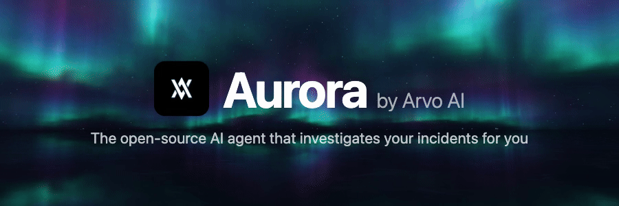

<div align="center">

[English](README.md) | **简体中文**



<a href="https://github.com/Arvo-AI/aurora/stargazers"></a>&nbsp;
<a href="https://github.com/Arvo-AI/aurora/releases/latest"></a>&nbsp;
<a href="https://github.com/Arvo-AI/aurora/blob/main/LICENSE"></a>&nbsp;
<a href="https://discord.com/invite/ccbN4FwHxM"></a>

<br />

<a href="https://aurora-ai.net">在线试用</a>&nbsp;&nbsp;&bull;&nbsp;&nbsp;<a href="#快速开始">快速开始</a>&nbsp;&nbsp;&bull;&nbsp;&nbsp;<a href="https://arvo-ai.github.io/aurora/">文档（英文）</a>&nbsp;&nbsp;&bull;&nbsp;&nbsp;<a href="https://www.aurorasre.ai">官网</a>&nbsp;&nbsp;&bull;&nbsp;&nbsp;<a href="CHANGELOG.md">Changelog</a>

</div>

<br />

**Aurora 是一个开源 AI SRE 智能体（open-source AI SRE agent）：告警一到，Aurora 就在你的云平台、Kubernetes 和可观测性工具中展开调查，并把根因分析（RCA）交到你手上。**

开箱即用的智能体，而不是用来自己搭建智能体的框架。完全自托管，Apache 2.0 许可，可接入你自己的 LLM。

- **用证据说话：** 在 19 种注入的 Kubernetes 故障上的[基准测试](https://www.aurorasre.ai/benchmark)，可用 [Aurora Lab](https://github.com/Arvo-AI/aurora-lab) 复现，失败的案例也一并公开
- **交流讨论：** [Discord](https://discord.com/invite/ccbN4FwHxM)
- **觉得有用？** 请[给仓库点个 Star](https://github.com/Arvo-AI/aurora/stargazers)，让更多 SRE 发现它

```bash
git clone https://github.com/Arvo-AI/aurora.git && cd aurora && make init
# add one LLM key to .env: OPENROUTER_API_KEY, OPENAI_API_KEY or ANTHROPIC_API_KEY
make prod-prebuilt       # then open http://localhost:3000
```

需要 Docker。首次启动后还需要设置一次 Vault token，详见下方[快速开始](#快速开始)。

---

## 快速开始

在本地运行 Aurora，大约 5 分钟：

```bash
git clone https://github.com/arvo-ai/aurora.git && cd aurora

make init                # Generate secure secrets
nano .env                # Add your LLM API key (OpenRouter, OpenAI, etc.)
make prod-prebuilt       # Pull prebuilt images and start
```

打开 **http://localhost:3000**。第一个注册的用户会成为管理员（admin）。

> [!TIP]
> Aurora 不需要任何云服务商账号即可运行。唯一的外部依赖是一个 LLM API key，各类 connector 都是可选的。

<details>
<summary><strong>Vault 设置（首次启动后必需）</strong></summary>
<br />

```bash
# Get the auto-generated root token
docker logs aurora-vault-init 2>&1 | grep "Root Token:"

# Add it to .env
echo "VAULT_TOKEN=hvs.your-token-here" >> .env

# Restart to connect services to Vault
make down && make prod-prebuilt
```

</details>

<details>
<summary><strong>固定版本</strong></summary>
<br />

```bash
make prod-prebuilt VERSION=v1.2.3
```

</details>

<details>
<summary><strong>从源码构建</strong></summary>
<br />

```bash
make prod-local
```

</details>

### 部署方式

| 方式 | 适用场景 |
|------|----------|
| `make prod-prebuilt` | 本地评估、单节点 |
| [Helm chart](https://arvo-ai.github.io/aurora/docs/deployment/kubernetes) | 生产环境 Kubernetes（GKE、EKS、AKS） |
| [Air-tight bundle](https://arvo-ai.github.io/aurora/docs/deployment/vm-deployment#secure-deployment-air-tight) | 离线 / 受限网络环境 |

---

功能介绍、集成列表、架构和安全说明请参阅[英文 README](README.md)。

## 许可证

[Apache License 2.0](LICENSE)，永久免费，不按席位或事件收费。
